

# 📱 Awesome Mobile Apps

### 317 tiny apps & games. Single HTML files. Zero install. Zero ads. Zero tracking.

Made with **[Masala](https://github.com/samosa-ai-com/Masala-AI-Launcher)**, the AI launcher for Android: each one written in a single shot from one request by Muse Spark Open 1026, Meta's open-weight model.

[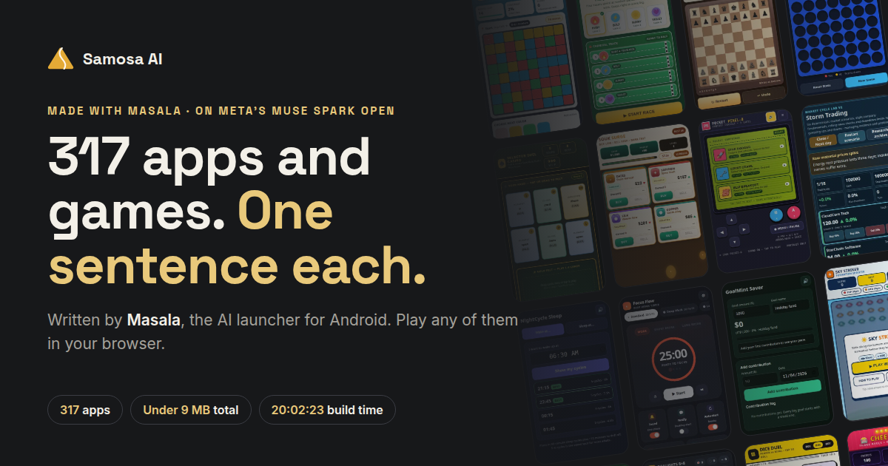](https://samosa-ai-com.github.io/awesome-mobile-apps/)

**No install · No ads · No accounts · No tracking · Works in airplane mode ✈️**

**▶️ [Play them in your browser →](https://samosa-ai-com.github.io/awesome-mobile-apps/)**

---

Copy any file to a phone and open it — it just runs. Each app is one
self-contained `.html` file (8.5 MB for the whole collection), saves its own data
on-device with `localStorage`, and talks to no server, because there is nothing
to phone home to.

## 🚀 Get started

| Way | How |
|-----|-----|
| **Browse** | Open [`index.html`](index.html) in any browser — search, filter by topic, tap **Open app** |
| **Single file** | Grab any `.html` under [`games/`](games) or [`apps/`](apps) — message it, email it, keep it in Downloads |
| **Whole collection** | Clone this repo, or download as ZIP and unzip on the phone |
| **GitHub Pages** | **▶️ [Play them in your browser](https://samosa-ai-com.github.io/awesome-mobile-apps/) — search, tap, play** |

> Tip: on Android, open a file with Chrome → menu → **Add to Home screen** for an app-like icon.

## ✨ What's inside

292 games + 25 everyday tools, all portrait phone layouts with
thumb-sized touch controls, readable without zoom, progress and settings saved
on-device. Sound (where present) is synthesized in-page with a mute toggle —
no audio files, no autoplay.

| Folder | Apps |
|--------|------|
| `apps/health` | 6 |
| `apps/home` | 4 |
| `apps/money` | 3 |
| `apps/tools` | 12 |
| `games/action` | 13 |
| `games/arcade` | 39 |
| `games/card-board` | 11 |
| `games/casual` | 13 |
| `games/creative` | 2 |
| `games/educational` | 8 |
| `games/fighting` | 3 |
| `games/finance` | 1 |
| `games/learning-quests` | 29 |
| `games/misc` | 29 |
| `games/music` | 2 |
| `games/puzzle` | 52 |
| `games/quiz` | 16 |
| `games/racing` | 5 |
| `games/rpg` | 3 |
| `games/shooter` | 12 |
| `games/simulation` | 15 |
| `games/sports` | 22 |
| `games/strategy` | 15 |
| `games/word` | 2 |

## 📖 An example

**Sudoku** (`games/puzzle/sudoku.html`) — full 9×9 with notes mode, mistake
highlights, difficulty levels, and best-times per difficulty. Open the file,
tap a cell, tap a number. Done. No tutorial needed, no permissions asked.

Every entry in the gallery carries a short description plus a
**How to play** expander, so nothing is a mystery box.

## ⭐ Featured

A dozen worth opening without thinking —
[try them all](https://samosa-ai-com.github.io/awesome-mobile-apps/).

| | | | | | |
|---|---|---|---|---|---|
| [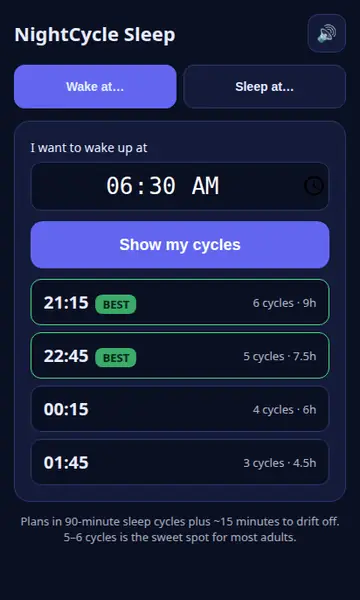](https://samosa-ai-com.github.io/awesome-mobile-apps/#sleep-calculator) | [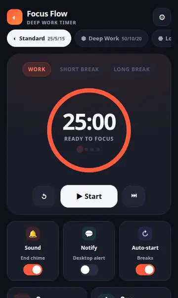](https://samosa-ai-com.github.io/awesome-mobile-apps/#pomodoro-plus) | [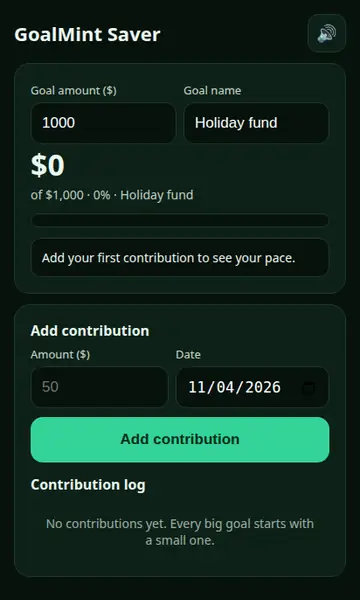](https://samosa-ai-com.github.io/awesome-mobile-apps/#savings-goal) | [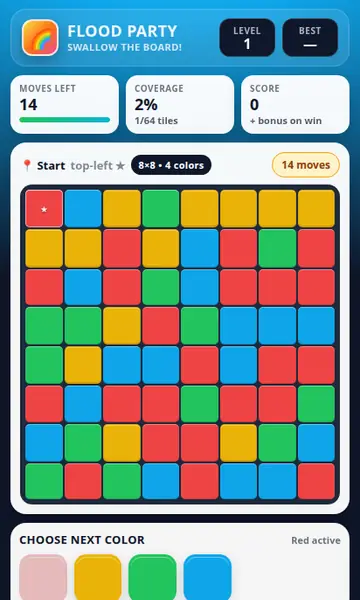](https://samosa-ai-com.github.io/awesome-mobile-apps/#flood) | [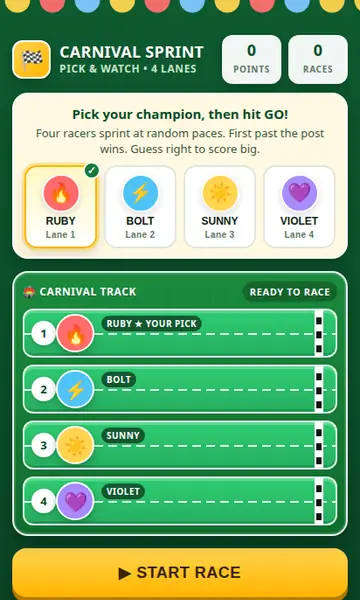](https://samosa-ai-com.github.io/awesome-mobile-apps/#horse-racing) | [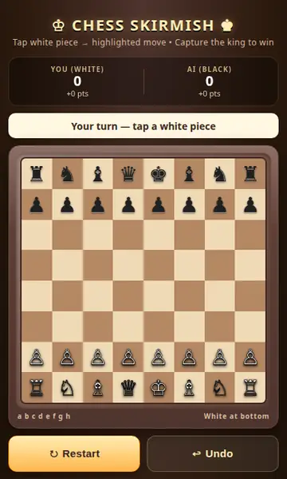](https://samosa-ai-com.github.io/awesome-mobile-apps/#classic-chess) |
| [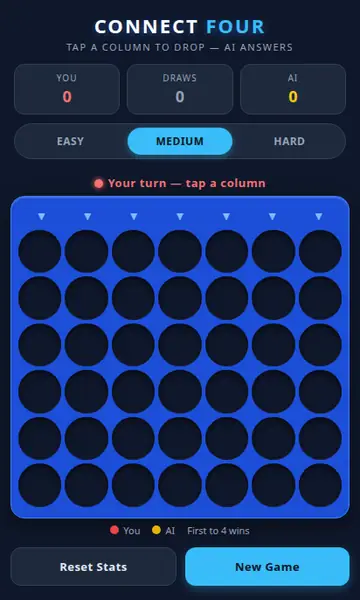](https://samosa-ai-com.github.io/awesome-mobile-apps/#four-in-a-row) | [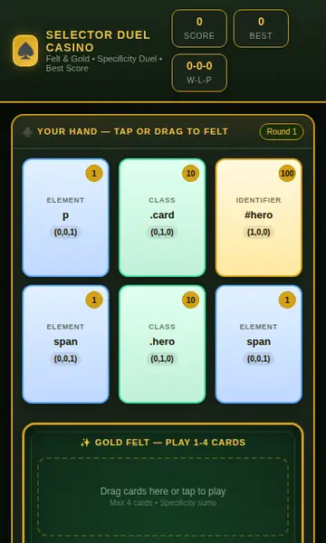](https://samosa-ai-com.github.io/awesome-mobile-apps/#specificity-wars) | [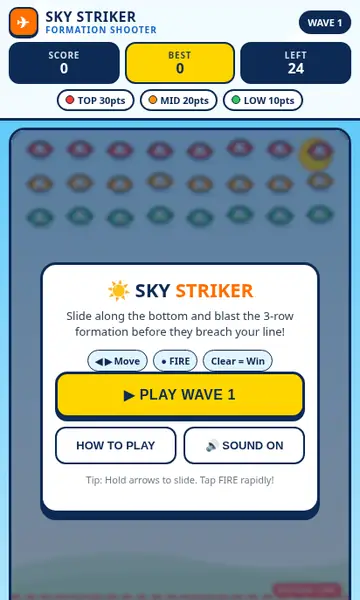](https://samosa-ai-com.github.io/awesome-mobile-apps/#little-bee) | [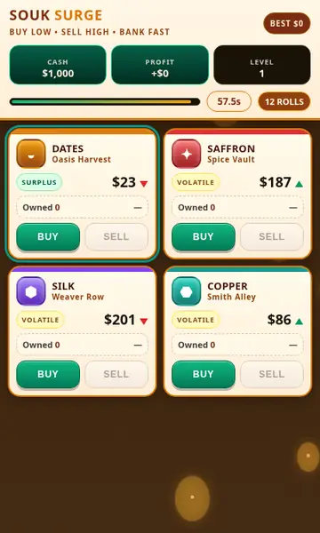](https://samosa-ai-com.github.io/awesome-mobile-apps/#bazaar) | [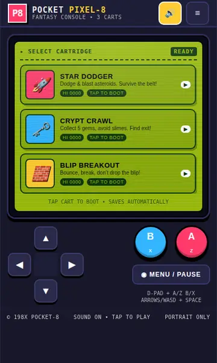](https://samosa-ai-com.github.io/awesome-mobile-apps/#pico-life) | [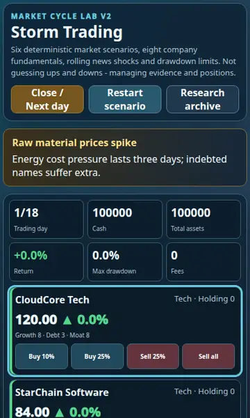](https://samosa-ai-com.github.io/awesome-mobile-apps/#market-pulse) |

## 💡 Why this exists

A small puzzle game shouldn't cost 200 MB, a login screen, and your attention
span. Store apps monetize through ads and telemetry; these files have neither —
they *can't* track you. They're also great for kids' phones, low-storage
devices, travel, and classrooms: the content is fixed, offline, and safe.

## 🛠️ Make your own

Any file is a starting template: plain HTML/CSS/JS with no build step.
Copy one, edit the text, change the colors, and you have your own variant.
MIT licensed — take them, remix them, ship them.
